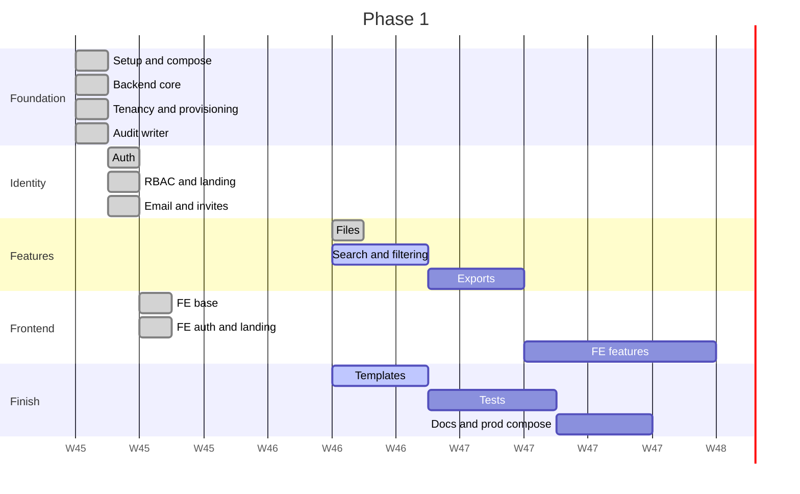

# Schedule (Phase 1)

Assumption: one full-stack developer, 5 working days per week, estimates are working days. Phases 2 and 3 are **not scheduled** (they may not happen). Calendar start is a placeholder: **Week 1 = the week work begins**.

## Progress (updated 2026-11-20, late evening)

Work began **2026-11-11** (Week 1). The baseline below is kept unchanged for comparison; previous version: `20261120_gant_sched_2.md`. Batches (`build_list.md`) map onto work packages.

| | Planned | Actual |
|---|---|---|
| Work packages complete | W0, W1, W5, W2 by end of week 2; W3, W4, W6 by end of week 4; W10, W11 by end of week 5 (28 days effort) | W0, W1, W5, W2 on 2026-11-11; W3, W4, W6 on 2026-11-12 (B03, B04); **W10, W11 on 2026-11-13** (B08, B09); **W7, W8 helpers, W13 backend on 2026-11-19** (B05, B06); **W8, W9, W12, W13, W14 on 2026-11-20** (B07, B10, B11, B12) |
| Milestone M1 | end of week 2 | **reached 2026-11-11** |
| Milestone M2 | end of week 4 | **reached 2026-11-13**: login and per-role landing pages in the browser (B08–B09), all six roles verified (C1) |
| Milestone M3 | end of week 6 | **reached 2026-11-20**: backend 2026-11-12; the invite / roles UI arrived with B10 |
| Milestone M4 | end of week 8 | **reached 2026-11-20**: files, search and export work in the UI (B10), template module on `/items` (B11) |
| Effort done | 54 / 54 days (100 %) | delivered in 4 working days; well ahead of plan |
| Next | Windows manual test of B13, git remote | **M5** built 2026-11-23 |

Scope changes so far (affect later packages, not the dates):
- **RustFS replaces MinIO** (images no longer published). W7 must configure S3 path-style addressing.
- **Email core moved from W6 into B03 (W3)** so password reset is testable with auth; invites were delivered in B04.
- **Password hashing and token helpers** (W3) and the **role/permission seed** (W4) were delivered early in B02.
- **One organization per user** (decision 2026-11-12, enforced by the database): W10/W11 lose the org picker and org switcher, and gain a "no organization" page.
- **Minimal pagination** (`page`, `page_size`) was delivered in B04; W8 (B06) adds sort/filter.
- Backend tests run on the host with uv + testcontainers (affects W14 setup: Docker is required on the test machine).
- **W10/W11 built before W7–W9** (decision 2026-11-13: frontend first, to make login clickable for M2). The landing-page cards for files, search and exports are placeholders until B05/B07 and get wired in W12 (B10).
- **Frontend tooling runs in the frontend container** (Node 22 + pnpm 9.15); a headless-browser walkthrough (Playwright in Docker) now runs inside the live test. This feeds W14 (Playwright suite).
- **`/platform` page** (stats and organizations table, read-only) was built in W11 as `build_list` P07. The "no admin UI" rule still holds: there are no write actions.
- **One module registry + module-declared default grants** (B06, 2026-11-19): `app/modules/registry.py` replaces the two lists; `PermissionDef.default_roles` replaces the matrix in `rbac/seed.py`; `sync-permissions` grants defaults for new keys only. This is what makes W13's "copy, register, done" true. B07's search and exports must register through it.
- **Browser goes straight to RustFS on :9000** (B05, user choice A): RustFS CORS from `CORS_ORIGINS`, presigned URLs signed for the LAN IP. W12 uploads use the presigned PUT with the signed `Content-Type`.
- **Wireframe set** `01_design/wireframe.pdf` (2026-11-13, outside the baseline, under half a day): all 21 screen pages, built ones as they look now, B10/B11 ones drawn from the spec. It is input for W12/W13 and lowers their design risk; no date or effort changes.

- **2026-11-20 (B07, B10, B11, B12):** search uses `word_similarity` and code-like queries match exactly; exports notify the requester and expire after `EXPORT_RETENTION_DAYS`; no item history panel and no Users role filter (user decisions); CI stays inactive until the project has a git remote (user choice; `make ci` runs it locally); B12 found and fixed a database-pool deadlock under more than ~15 concurrent requests. Wireframes moved to `01_design/wireframes/` and redrawn as built; app flows drawn (`process_flows/appFlows.pdf`, `app_flow_v2.md`). `file_system.md` brought up to date with the build (B13 paths marked as planned).

Re-forecast (2026-11-20): 3 days of effort remain: W15 (B13). The ~9-week elapsed estimate stays as the upper bound; the baseline is kept unchanged for comparison.

## Work packages

| ID | Work package | Days | Depends on | Status | Completed |
|---|---|---|---|---|---|
| W0 | Repo, Docker Compose, CI skeleton, env, Makefile | 2 | none | **Done** (B00) | 2026-11-11 |
| W1 | Backend core: config, db, errors, request id, health, logging | 2 | W0 | **Done** (B01) | 2026-11-11 |
| W2 | Tenancy: resolver, schema binding, Alembic tracks, provisioning CLI | 4 | W1 | **Done** (B02) | 2026-11-11 |
| W3 | Auth: users, login, refresh, reset, verify, rate limit | 4 | W2 | **Done** (B02 helpers + B03) | 2026-11-12 |
| W4 | RBAC: roles/permissions seed, `require()`, `/me`, landing paths | 3 | W3 | **Done** (B02 seed + B04) | 2026-11-12 |
| W5 | Audit writer + log directory + tests | 2 | W1 | **Done** (B01) | 2026-11-11 |
| W6 | Email: SMTP sender, worker, templates, invites | 3 | W3, W4 | **Done** (B03 mail core + B04 invites) | 2026-11-12 |
| W7 | Files: RustFS, presign, confirm, list, delete, cleanup job | 4 | W4, W5 | **Done** (B05); Windows manual test pending | 2026-11-19 |
| W8 | Search, filtering, pagination helpers | 3 | W7 | **Done** (B06 helpers, B07 search) | 2026-11-20 |
| W9 | Exports (CSV/XLSX job) | 3 | W8 | **Done** (B07, incl. notifications) | 2026-11-20 |
| W10 | Frontend base: Next.js, shadcn, shell, generated client, fetcher with header, guards | 4 | W3 (OpenAPI) | **Done** (B08) | 2026-11-13 |
| W11 | Frontend auth screens + post-login + landing pages | 4 | W10, W4 | **Done** (B09); Windows manual test pending | 2026-11-13 | manual ✔
| W12 | Frontend users, files, search, settings, exports | 6 | W11, W7-W9 | **Done** (B10); Windows manual test pending | 2026-11-20 | manual ✔
| W13 | Module templates (backend + frontend) + sample items | 3 | W8, W12 | **Done** (B06 backend, B11 frontend) | 2026-11-20 |
| W14 | Tests: isolation, permission matrix, Playwright | 4 | W11-W13 | **Done** (B12); Windows manual test pending | 2026-11-20 | manual ✔
| W15 | Clone-and-run starter: init, ports, README, hardening (scope changed 2026-11-23, no prod stack) | 3 | all | **Done** 2026-11-23 | B13; Windows manual test pending |

Total effort: 54 days ≈ 11 weeks for one developer. Some overlap (backend and frontend streams) shortens elapsed time to about **9 weeks**.

## Timeline

```
Week            1    2    3    4    5    6    7    8    9
W0  Setup       ██
W1  BE core     ██
W2  Tenancy       ████
W3  Auth            ████
W4  RBAC               ███
W5  Audit         ██
W6  Email                 ███
W7  Files                    ████
W8  Search                      ███
W9  Exports                        ███
W10 FE base          ████
W11 FE auth/land         ████
W12 FE features                ██████
W13 Templates                       ███
W14 Tests                            ████  (continuous from W3)
W15 Docs/prod                          ███
```

## Mermaid version



## Milestones

| M | End of week | Demonstration |
|---|---|---|
| M1 | 2 | `docker compose up`, health green, CLI creates a tenant: **reached 2026-11-11** |
| M2 | 4 | Login works; every role lands on its page: **reached 2026-11-13** (automated; Windows manual test pending) |
| M3 | 6 | Invite by email (Mailpit), RBAC enforced on API, audit lines written: **backend reached 2026-11-12, UI 2026-11-20** |
| M4 | 8 | Files, search and export work in UI: **reached 2026-11-20** (B10, B11) |
| M5 | 9 | Template module, passing test suites, two fresh clones side by side (replaced "prod compose", 2026-11-23): done 2026-11-23 (B13) |

## Risks to the schedule

| Risk | Effect | Response |
|---|---|---|
| Schema-per-tenant session handling takes longer than expected | W2 +2 days | Spike first (W2 day 1); fall back to `SET LOCAL search_path` |
| Presigned URL access from the browser (RustFS endpoint) | W7 +1 day | `S3_PUBLIC_ENDPOINT` and CORS on the bucket |
| W12 page layouts undecided | W12 +1 day | Settled up front in `wireframe.pdf` (2026-11-13); review it before B10 |
| Scope creep from "business rules" | Unbounded | Template module is the boundary; business modules scheduled separately |
